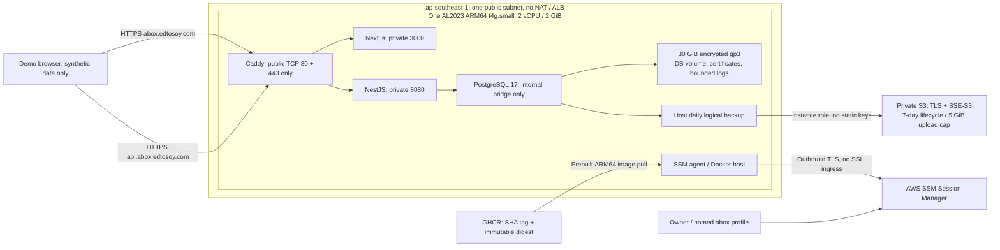

# abox — Phase 3A AWS demo preparation

**Current region: Sydney (`ap-southeast-2`), confirmed by the owner.** See the
[latest Sydney readiness results](aws-sydney-readiness-2026-10-28.md). Geographic
settings and prices below describe historical Singapore preparation; they are
superseded by the current Terraform, deployment runbook and Sydney report.

**Credit-check update:** individual credit-expiry and service-specific credit
applicability verification are owner-waived under [ABOX-RISK-001](aws-demo-risks.md).
Historical grant-date requirements below are superseded; waived does not mean
verified. Use the [guarded planning checklist](../infra/aws-state/planning-checklist.md)
for current account/balance/plan-window and secure-storage requirements.

**State-storage update (2026-10-28):** the [dedicated S3 backend preparation](../infra/aws-state/README.md)
supersedes the local-backend design below. Both remote state and protected local
plan handling remain NO-GO until separately approved bootstrap and verified
encrypted workspace requirements are met. This historical report is not current
authorization to initialize a backend or provision resources.

Prepared 2026-10-25 on `main`, starting at `83853cb161fee47cc98a930251db839667f86d20`.
The initial working tree was clean. The owner's latest button-color and generated
framework-instruction commit is preserved. No application source, historical
Kubernetes/Ansible/Terraform configuration, or legacy AWS/ECR workflow is changed.

**Recommendation: NO-GO for Phase 3B deployment now.** Local preparation is ready
for review, but the intended new Free-plan account is not configured/verified.
In a later owner-requested read-only check, `kuyas-general` resolved to an account
ending **0564** and reported **PAID / ACTIVE**. Checks stopped there: this profile
does not satisfy the Free-plan constraint. Credit balance/expiry, permissions,
quotas, and secure state storage for the intended Free account remain unverified.
Native ARM64 application execution and live HTTPS/SSM/S3 recovery also remain
gates. No real Terraform plan, apply, provisioning, image publication, commit,
push, or account-plan change occurred in Phase 3A.

## Architecture and decisions

The design deliberately accepts single-instance/AZ downtime for a small demo.
Builds happen on a native GitHub ARM runner, not on the 2-GiB host. No Kubernetes,
RDS, ECR, NAT gateway, load balancer, Elastic IP, paid customer-managed KMS key,
Route 53 zone, Organizations, or auto-upgrade feature is introduced. The public
IPv4 is ephemeral: stop/start requires DNS review/update. Account operations were
initially deferred; profile inventory exposed **names/field types only**. The
subsequently requested `kuyas-general` check made only STS identity and Free Tier
plan-state reads, then stopped on PAID. No default/iamadmin profile was invoked,
and no EC2/S3/IAM resource query or modification followed.

Supported OS choice is Amazon Linux 2023 ARM64, resolved from the Amazon-owned
public AMI parameter and constrained to `arm64`. AL2023 is supported through
June 2029; this avoids AL2, whose standard support has ended.
[AWS AL2023 release cadence](https://docs.aws.amazon.com/linux/al2023/ug/release-cadence.html).

## File inventory

| Files | Purpose |
| --- | --- |
| `infra/aws-demo/{versions,variables,main,iam,outputs}.tf` | Isolated Terraform root, explicit profile/account allowlist, one instance, network/firewall, scoped runtime IAM, private encrypted backup bucket/lifecycle |
| `infra/aws-demo/user-data.sh` | Non-secret AL2023 Docker/SSM/Compose bootstrap; no app or database startup |
| `infra/aws-demo/terraform.tfvars.example`, `.gitignore`, `.terraform.lock.hcl` | Intentionally blocking account examples, private state/plan exclusions, AWS provider 6.56.0 and existing matching checksum set |
| `deploy/aws-demo/compose.yml`, `Caddyfile`, `backend-runtime.cjs`, `init-db.sh` | Bounded production services, HTTPS routing, file-secret adapter, non-superuser PostgreSQL application role |
| `deploy/aws-demo/{common,preflight,generate-secrets,release,backup,restore}.py` | Guarded future owner/host operations; no default profile, mutable images, automatic destructive rollback, or printed secrets |
| `deploy/aws-demo/abox-backup.{service,timer}` | Reviewed daily host backup schedule and bounded backup process memory/CPU |
| `deploy/aws-demo/release.env.example`, `budget.example.json`, `.gitignore` | Non-secret configuration and gross-cost budget planning; no actual account IDs/emails/passwords |
| `deploy/aws-demo/test_safety.py`, `README.md` | Offline guard tests and detailed future deployment, backup, restore, rollback, and shutdown commands |
| `.github/workflows/abox-images.yml` | Manual native ARM build/check, optional separately approved GHCR publication; no AWS credentials or deployment |
| `Dockerfile.backend`, `Dockerfile.frontend` | Optional `NODE_IMAGE` argument to pin the same reviewed multi-architecture Node 22 digest; existing default behavior retained |
| `.dockerignore`, root `README.md`, this report | Exclude private runtime/state/recovery material from build contexts and document the isolated preparation path |

Provider selection reuses the repository's existing AWS **6.56.0** package and
matching checked-in checksum set; the historical lock/provider files are not
modified. Resource behavior was reviewed against that version's official
[instance documentation](https://github.com/hashicorp/terraform-provider-aws/blob/v6.56.0/website/docs/r/instance.html.markdown).

## Eligibility, Free-plan guardrails, and unknowns

Owner statement: a family member has a new Free-plan account with $100 starting
credits and has authorized their use. **This is not independently verified.**
The owner initially elected to configure it later, then asked to try
`kuyas-general`. That profile's plan read returned PAID/ACTIVE, making it unsuitable
for this Free-plan deployment. No upgrade/downgrade or further account checks
were attempted. Full identity and plan response are retained only in a mode-0600
file inside a private mode-0700 directory under `/tmp/abox-phase3a/`, never in
source control or this report. Terraform requires a dedicated `abox-*` profile
and an exact allowed account ID. The shipped example ID and
`free_plan_verified=false` deliberately
block plan/apply until the owner completes preflight.

AWS describes Free-plan access as ending after six months or credit exhaustion,
whichever happens first. Paid-plan upgrades and Organizations/Control Tower can
change eligibility; none is part of this implementation. The intended zero
out-of-pocket outcome depends on the account staying Free and using permitted
services; budgets are not the mechanism that guarantees it. Preserve account-owner
control and do not accept a Paid upgrade to bypass a service restriction.
[AWS Free Tier FAQ](https://aws.amazon.com/free/free-tier-faqs/).

**Do not assume the separate T4g 750-hour promotion applies.** AWS's current
billing guidance says Free-plan accounts receive only Always Free offers, while
short-term trials are available to Paid-plan accounts. Therefore this Free-plan
deployment budgets T4g small at the normal list rate against credits. T4g small
is still one of the selectable credit-funded instance types. The general T4g
trial is advertised through December 31, 2026, but that is not a reason to upgrade.
[AWS offer eligibility](https://docs.aws.amazon.com/awsaccountbilling/latest/aboutv2/tracking-free-tier-usage.html),
[new EC2 Free Tier model](https://docs.aws.amazon.com/AWSEC2/latest/UserGuide/ec2-free-tier-usage.html),
[T4g offer FAQ](https://aws.amazon.com/ec2/faqs/).

The updated `preflight.py` checks only after explicit profile/account input:
identity first, FREE/ACTIVE state, minimum $75 credit balance, at least 69 days to
both plan expiry and the owner-verified earliest credit expiry supplied with
`--credit-expiration-date`, T4g small ARM64/2-GiB specification, Singapore AZ offering, at least
2 Standard On-Demand vCPUs, and public AMI parameter access. It writes a private
three-hour approval with an account hash and runway assertion, not raw billing
amounts or identity/credentials. It fails closed on denied/unknown checks. It
does not create/join Organizations, upgrade a plan, request quotas, or provision.
[AWS account-plan API](https://docs.aws.amazon.com/cli/latest/reference/freetier/get-account-plan-state.html).

Still unknown for the intended Free account: creation/expiry and remaining credits; actual service
access (particularly SSM/Budgets); IAM permissions; regional account quotas and
capacity; DNS/CAA control; availability of secure encrypted operator state
storage; and the owner's shutdown/notification arrangements. No claim is made
that the current family account can already launch or administer this stack.

## Monthly gross estimate before credits

USD, 730 active hours/month, one host, no compute/IPv4 trial discount assumed.
Public AWS price data was read anonymously, without any AWS account/profile.

| Item | Assumption / public unit rate | Monthly USD |
| --- | --- | ---: |
| T4g small Linux, Singapore | 730 × $0.0212/hour | 15.476 |
| Encrypted gp3 root EBS | 30 GiB × $0.096/GB-month; included 3000 IOPS / 125 MiB/s only | 2.880 |
| One in-use public IPv4 | 730 × $0.005/hour | 3.650 |
| S3 Standard backup storage | Conservative 5 GB × $0.025/GB-month | 0.125 |
| Backup PUT/LIST/HEAD requests | About 30 daily dumps, small request counts; allow ~$0.01 | 0.010 |
| SSM standard EC2 sessions / IAM / VPC / same-region backup transfer | No advanced sessions, NAT, paid endpoints, or detailed monitoring | 0.000 |
| Internet egress | Small demo under the account-wide 100-GB monthly allowance; verify other usage | 0.000 |
| **Estimated gross total** | Before credits, taxes, or unforeseen usage | **22.141 (~$22.14)** |

Primary rate evidence: AWS EC2 SKU `MZGPYWV687EP4MDV` (Shared Linux, On-Demand,
no preinstalled software) and gp3 SKU `X8SY8CJFS8WV7VQN` in the
[official Singapore EC2 price CSV](https://pricing.us-east-1.amazonaws.com/offers/v1.0/aws/AmazonEC2/current/ap-southeast-1/index.csv);
S3 `APS1-TimedStorage-ByteHrs` first tier in the
[official Singapore S3 price JSON](https://pricing.us-east-1.amazonaws.com/offers/v1.0/aws/AmazonS3/current/ap-southeast-1/index.json).
Public IPv4 is separately metered at $0.005/hour;
[AWS VPC pricing](https://aws.amazon.com/vpc/pricing/).
The 100-GB outbound allowance is shared across services/regions, not a dedicated
abox allowance; excess egress, abuse, other account workloads, and requests can
consume credits faster. [AWS data transfer pricing](https://aws.amazon.com/ec2/pricing/on-demand/).

Budget **$25/month gross**, excluding promotional credits/refunds so consumption
stays visible. Starting at $100, the estimate gives about **4.5 months** to zero
credits or **3.4 months** until a $25 shutdown reserve remains; either is shortened
by the six-month plan expiry, taxes, extra account use, or unexpected traffic.
A seven-day acceptance trial is roughly $5.2 plus storage/request variations.
Stopped compute releases the ephemeral public IP, but EBS/S3 continue consuming
credits. Domain renewal, the owner's internet charges, and any other services are
not included; no domain purchase is authorized.

The repo is confirmed public. Standard public GitHub-hosted ARM runners are
currently free, and GHCR container storage/bandwidth is currently free. Recheck
these terms/visibility before triggering the new workflow; no workflow was
triggered or image published here.
[GitHub runner terms](https://docs.github.com/en/actions/reference/runners/github-hosted-runners),
[GHCR billing](https://docs.github.com/en/billing/concepts/product-billing/github-packages).

## Runtime, ARM64, and 2-GiB assessment

Both production Docker images built successfully **locally on amd64 using Node
22 Alpine**. The frontend embeds the intended HTTPS API URL. Build context stays
small and excludes local dependencies, env/secrets, Terraform state/plans, dumps,
and generated reports. Both app images run as UID 1000. No dependency was added.

Registry manifests for the pinned Node 22 Alpine, PostgreSQL 17 Alpine, and Caddy
2 Alpine indexes include Linux ARM64. The prepared workflow builds natively on
`ubuntu-24.04-arm`, checks architecture, exercises bcrypt and Sharp, and checks
packaged migrations. Native host builds also proved the existing backend package
contains migrations/seed and successfully starts. **This local Docker builder
supports amd64 only; native ARM execution was not performed, and no emulation
handler or remote runner was installed/started.** ARM workflow success is a gate,
not a result claimed by this report.

The disposable amd64 production stack passed migration, synthetic seed,
non-superuser app-role checks, production cookie flags, accepted HTTPS Origin,
synthetic login/session/logout, frontend/Caddy responses, and PostgreSQL logical
dump/restore into a separate candidate DB. No real data or AWS calls were used.

Under 200 health/login-page requests at concurrency 5, four Docker working-set
samples reported these maxima (MiB):

| Service | Sampled peak | Container limit |
| --- | ---: | ---: |
| PostgreSQL | 24.00 | 320 |
| NestJS | 50.06 | 384 |
| Next.js | 39.51 | 384 |
| Caddy | 13.04 | 96 |
| **Sum of individual sampled peaks** | **126.61** | **1184** |

This supports **plausible viability for a small, low-traffic synthetic demo**.
It does not prove sustained clinical workload capacity, TLS peak behavior,
ARM-native memory use, simultaneous query/resize bursts, or a hard 2-GiB VM
limit including AL2023/Docker/SSM. The fixture used local HTTP Caddy only and
did not issue certificates. Reserve roughly 600-700 MiB for host/agent/cache
and backup processes; maintenance jobs run sequentially with web processes
stopped. Require representative ARM64 smoke/use tests, no OOM/restart loop,
at least 400 MiB host available memory, and adequate disk before public access.
Do not solve a failed memory gate by silently changing instance size or enabling
Unlimited CPU credits. Standard mode limits surplus-credit charges by throttling.

## HTTPS, data, secrets, and administration

Only Caddy publishes TCP 80/443; HTTP redirects/challenges are intentional.
PostgreSQL has no published host port and an internal network. Backend/frontend
also have no host ports and no direct outbound internet network. Caddy alone
bridges the web network to the private app network. Only the backend/jobs reach
the separate DB network. SSM uses outbound TLS, not inbound SSH. IMDSv2 is required
with hop limit 1; no container uses host networking or gets AWS credentials.
Runtime IAM permits only SSM registration/session channels and this bucket's
`demo/` backup objects/list prefix, with no object deletion/billing/EC2 provisioning.

The app cookie/CORS design is unchanged: production Secure/HttpOnly/Lax host-only
API cookies, credentialed fetch, exact `https://abox.edtosoy.com` CORS, same-site
HTTPS subdomains. Cross-origin is not cross-site here. TLS/real browser behavior
still needs verification after DNS/issuance; it was not simulated as a live
certificate test. Caddy automatic HTTPS is explicitly configured by fixed
hostnames. [Caddy HTTPS requirements](https://caddyserver.com/docs/automatic-https).

Secrets are generated on the host after owner approval and mounted as Compose
file secrets. A deployment-only adapter reads them into the backend process;
no application business/auth code is changed, and Docker's configured env/state/
user data contains no secret values. The host secret directory remains 0700 and
secrets never enter the checkout. File-secret mount contents need to be readable
by their non-root consumers; this is protected local storage, not a managed vault.
[Compose file secrets](https://docs.docker.com/reference/compose-file/secrets/).

PostgreSQL has a separate bootstrap admin secret and a NOSUPERUSER/NOCREATEDB/
NOCREATEROLE `abox_app` database owner for migrations/runtime. Backend/frontend
are non-root/read-only, drop capabilities, and have bounded writable tmpfs/cache.
Caddy's admin API stays loopback/private. Access logs are discarded; DB statement/
error-parameter logging is suppressed; existing backend error metadata is
sanitized. Docker logs rotate. Do not add clinical data or print secrets while
debugging. The existing per-process auth limiter sees Caddy's IP (shared demo
login-rate bucket); no unreviewed trust-proxy change was made.

## Backups, recovery, notifications, and shutdown

Encrypted EBS protects live DB, TLS state, and temporary dumps. Daily/pre-release
PostgreSQL 17 custom-format backups go over TLS to private SSE-S3 storage with
SHA256 checksums, seven-day lifecycle and size/storage caps. Upload/restore checks
the expected bucket owner. The host role cannot delete backups. No paid KMS key,
AWS Backup plan, cross-region copy, immutable Object Lock, or managed backup
service is assumed. RPO ≤24 hours depends on successful monitoring; AWS RTO is
not established. Local candidate restore matched user digest, patient count,
and migration journal. Live S3 upload/download and instance-loss recovery are
**not run**. Keep external encrypted recovery copies before Free-plan expiry;
same-account S3 becomes inaccessible if the account loses access.

The [operator runbook](../deploy/aws-demo/README.md) contains exact owner preflight,
secure-state initialization/plan, separately authorized provisioning, GHCR
build/publication, SSM access, first/subsequent releases, backup scheduling,
candidate restore, schema-aware rollback, and shutdown instructions. It never
treats an image rollback as a database rollback. Primary volume termination is
destructive, so verify off-server/offline recovery first. No teardown is run here.

Notification planning uses a $25 whole-account gross cost budget with
`IncludeCredit=false` and `IncludeRefund=false`, actual thresholds 25/50/80/100%,
forecast 100%, and separate native credit/expiry alerts. Forecasts may not yet
exist on a new account; actual alerts/manual balance checks are still required.
Owner must confirm receipt and daily backup monitoring. Alerts are delayed and
are not a cap or automatic stop. Do not enable charged polling/paid automation.
Stop at $25 credit reserve or seven days before account expiry and export recovery
material while account access still works. [AWS budget cost-type options](https://docs.aws.amazon.com/cli/latest/reference/budgets/create-budget.html).

## Executed checks and limitations

| Check | Result |
| --- | --- |
| Git branch/status/history and latest Actions inspection | **PASS**: started clean at `83853cb`; current verification run [40158043153](https://github.com/EdTosoy/hospitalProject/actions/runs/40158043153) succeeded |
| `terraform fmt -check infra/aws-demo` | **PASS** |
| `terraform -chdir=infra/aws-demo init -backend=false -input=false -plugin-dir=/mnt/storage/projects/hospitalProject/terraform/.terraform/providers` | **PASS**, local cached provider only; secure backend not initialized |
| `AWS_CONFIG_FILE=/dev/null AWS_SHARED_CREDENTIALS_FILE=/dev/null AWS_EC2_METADATA_DISABLED=true terraform -chdir=infra/aws-demo validate` | **PASS** with local provider RPC permission; initial network-restricted sandbox could not start its plugin socket |
| `python3 -m unittest discover -s deploy/aws-demo -p 'test_*.py' -v` | **PASS**: offline guard tests, mocked subprocesses, no AWS calls |
| Python AST checks, `node --check deploy/aws-demo/backend-runtime.cjs`, shell `bash -n`, installed YAML parser | **PASS** for scripts and manual/nonpublishing image workflow |
| Production `docker compose config --format json` | **PASS**: only Caddy 80/443 publication, private networks, file secrets, memory caps, maintenance profiles |
| Pinned Caddy image `validate --config /etc/caddy/Caddyfile --adapter caddyfile`, network disabled | **PASS**; no issuance/listeners |
| Docker builds of backend/frontend with pinned Node 22 and production API URL | **PASS** on amd64; backend build/package and frontend TypeScript/16 routes |
| `python3 /tmp/abox-phase3a/runtime-probe.py` | **PASS**: uniquely labeled disposable fixture, 200 lightweight requests, synthetic auth, caps, role privileges, local dump/candidate restore; its own volumes/dumps/secrets removed |
| Public base-image manifests / bootstrap release assets | **PASS**: ARM64 variants, Compose v5.4.0 ARM64 binary/checksum asset availability |
| Requested `kuyas-general` identity and account-plan reads | **FAIL eligibility gate**: identity resolved (masked account ending 0564), plan PAID/ACTIVE; stopped without further account calls or plan changes |
| Intended Free account identity, credits, expiry, services/quotas, IAM execution, real plan/apply | **NOT RUN**: correct Free account/profile remains to be configured; no fallback used |
| Native ARM64 app build/run, AL2023/SSM bootstrap, GHCR publication, live DNS/ACME HTTPS, S3 upload/full instance recovery | **NOT RUN**: Phase 3B gates; no remote runner/workflow triggered |

Public-rate selections, base-image manifests and sanitized runtime measurements
are local in `/tmp/abox-phase3a/`. No generated data, secret files, dumps, images,
state, plans, or account responses are added to the repository. Passing validation
establishes local structure/packaging, not account eligibility or a deployable
credit balance. No repeat of unrelated app/UI test suites was necessary.

## Phase 3B acceptance / GO checklist

- [ ] Explicit owner authorization for the reviewed target account and exact plan;
  no default/Flow profile, Paid plan, Organizations, or paid-service workaround.
- [ ] Fresh identity/Free-plan/credit/expiry confirmation; secure encrypted state
  and private tfvars/plan location; owner-reviewed account IAM permissions.
- [ ] Confirm all required services and T4g capacity/quota in Singapore under Free.
- [ ] Native ARM64 builds/native modules and matching SHA labels/digests pass;
  approved GHCR publication and anonymous pulls work before allocating EC2.
- [ ] Reviewed plan contains only the intended single-host resources, encrypted
  30-GiB storage, Standard CPU credits, restricted IAM and 80/443 ingress.
- [ ] DNS/CAA ownership and no stale AAAA; SSM works without SSH; bootstrap checks
  pass; no real data; single migration and guarded initial synthetic seed succeed.
- [ ] Representative ARM host use/backup fits 2 GiB with no OOM and safe available
  RAM/disk; throttling is acceptable; no compile/build runs on the EC2 instance.
- [ ] Live HTTPS, Origin/cookie session lifecycle, six roles, and health/DB reads
  pass; backup upload/restore and schema-aware rollback are rehearsed.
- [ ] Gross-cost and credit/expiry notifications tested; daily backup checks and
  an owner-controlled shutdown/export schedule protect the $25 reserve.

Only after these gates are met is a short synthetic Phase 3B demo a conditional
GO. This is not a production clinical deployment or a guarantee of future AWS/
GitHub pricing. No live provisioning or publication was performed in Phase 3A.
